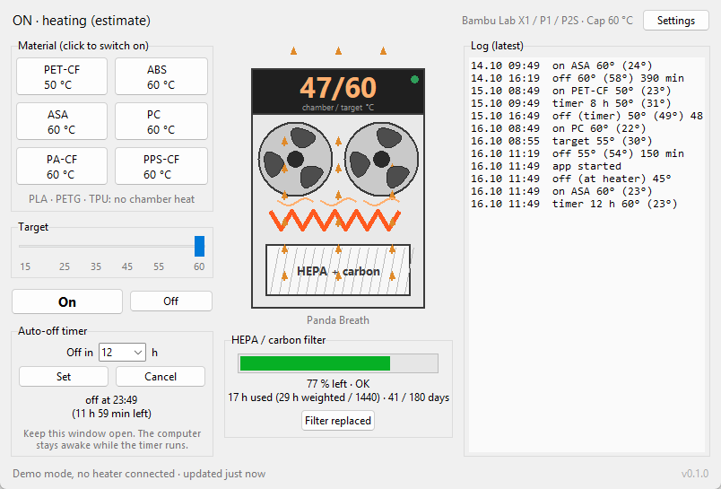

# Panda Breath Control

A desktop app for the BIQU Panda Breath chamber heater and air filter. It
talks to the heater over your home network and adds what the heater's own web
page lacks: one-click material presets, an auto-off timer, a filter wear gauge
and a run log.

I wrote it for a Panda Breath on an Elegoo Centauri Carbon 2, a printer BIQU
does not support, mostly because I wanted the heater to switch itself off
when a long print finished while I was away. It now has profiles for other
printers too.

This is an unofficial program, not affiliated with BIQU / BIGTREETECH. Read
[Safety](#safety) before you use it.

## What it does

- Material presets: one click sets the chamber target and switches the
  heater on in Forced On mode.
- Printer profiles with a temperature cap. Nothing above the cap is ever
  sent: generic enclosed printer 50 °C, Bambu Lab X1 / P1 / P2S 60 °C, Voron
  and other Klipper printers 60 °C, Elegoo Centauri Carbon 2 55 °C, or a cap
  you choose.
- An auto-off timer ("off in 12 h") that survives a restart of the app, keeps
  the computer from sleeping while it runs, and keeps sending "off" until the
  heater confirms it.
- A filter gauge: hours of use weighted by material, against Bambu Lab's
  1440 h carbon-filter interval or 180 days, whichever comes first.
- A run log as a CSV file you can open in a spreadsheet.
- A live view of the chamber reading and target, with a marker that turns
  red when the data is stale.
- English, Finnish and Simplified Chinese.
- A demo mode that runs without a heater, and a command-line tool for scripts.

## Requirements

- A Panda Breath V1.0 or V1.1 on firmware V1.0.2 or newer, already connected
  to your Wi-Fi. Tested with V1.0.4.
- A computer on the same network with Python 3.9 or newer, including tkinter.
  The python.org installers for Windows and macOS include it; on Debian or
  Ubuntu run `sudo apt install python3-tk`.
- The `websockets` package.

Tested on Windows 11. macOS and Linux should work, but have not been tested
yet. Reports are welcome.

## Install

### Windows

1. Install Python from [python.org](https://www.python.org/downloads/) and
   tick "Add python.exe to PATH" in the installer.
2. Download this repository (Code, Download ZIP) and unzip it somewhere
   permanent, or `git clone` it.
3. Open a terminal in that folder and run:

       pip install -r requirements.txt

4. Double-click `panda-breath-control.pyw`. To get a Start Menu entry instead,
   run once:

       powershell -ExecutionPolicy Bypass -File scripts\create-shortcut.ps1

### With pip (any system)

    pip install git+https://github.com/EeroVakiparta/panda-breath-control

This installs two commands: `panda-breath-control` (the window) and
`panda-breath` (the command-line tool).

### Try it without a heater

    python -m panda_breath_control --demo

The demo simulates a heater that warms up slowly. It keeps its own settings
and log, separate from the real ones.

## First start

1. Read and accept the disclaimer.
2. Open **Settings** and enter the heater's address. The factory hostname is
   `PandaBreath`, so `PandaBreath.local` usually works. If it does not, use
   the IP address, which you can find in your router's list of connected
   devices or on the heater's own web page (Wi-Fi & IP).
3. Pick your printer. The note under the list explains where its cap comes
   from.

The line at the bottom of the window shows whether the app is connected and
how old the last reading is.

## Using it

### Presets and target

A material button sets the target and switches the heater on. The slider
changes the target in 5 °C steps; if the heater is already on, the new target
is applied when you let go. **On** uses the slider value, **Off** switches the
heater off.

The display shows `chamber / target`. The chamber number comes from the
heater's own sensor, which sits next to the heating element and reads high:
one Bambu Lab user saw 60 °C on the Panda Breath while the printer measured
50 °C. Trust your printer's chamber sensor when it has one.

The heater does not report whether its element or fans are running.
"Heating" in the status line is an estimate: switched on and reading below
the target.

### Auto-off timer

Choose the hours (2 to 24 from the list, or type any value up to 48, for
example `1.5`), then **Set**. The box shows the switch-off time and how long
is left. **Cancel** stops it, and so does switching the heater off by hand,
in the app or on the heater.

The heater's Forced On mode has no timer of its own, so the app does the
switching off. That means:

- Keep the window open and the computer on. While a timer is set the app
  asks the operating system not to sleep (the screen can still turn off).
  Closing the window asks for confirmation, because the heater would stay on.
- If the app or the computer restarts, open the app again: the timer
  continues, and if the time has already passed, the heater is switched off
  straight away.
- The timer does not know about your print. Set it from the slicer's time
  estimate plus a margin.

### Filter gauge

Every run in the log counts towards the filter, weighted by material: PETG
1.0, PETG-CF 1.3, PET-CF and PC 1.5, PA and PPS 1.8, ABS and ASA 2.0. The
budget is 1440 weighted hours (Bambu Lab's figure for its carbon filter) or
180 days since the last change (BIQU says 3 to 6 months), whichever comes
first. The weights are a judgement, not a measurement: replace the filter
sooner if you smell fumes or the airflow drops. Press **Filter replaced**
after changing it.

### Run log

Every switch-on, switch-off, target change and timer event goes to
`panda_breath_log.csv` (semicolon-separated, which opens directly in Excel
with European regional settings):

    time;event;target_c;chamber_c;duration_min
    2026-10-15 08:45:00;on:PET-CF;50;23;
    2026-10-15 16:45:00;off:timer;50;49;480

Events: `on` or `on:<material>`, `off`, `off:timer`, `seen_on` / `seen_off`
(a change made on the heater itself or by another program, noticed within 30
seconds), `target`, `timer:<hours>h`, `timer_cancelled`, `timer_resumed`,
`filter_changed`, `app_start`, `app_close`.

### Where the files are

| System | Folder |
|---|---|
| Windows | `%APPDATA%\PandaBreathControl` |
| macOS | `~/Library/Application Support/PandaBreathControl` |
| Linux | `~/.config/panda-breath-control` |

The folder holds `settings.json`, the log, `filter.json` (date of the last
filter change) and `timer.json` (only while a timer is set). The environment
variable `PANDA_BREATH_HOST` overrides the heater address without changing
the settings.

### Command line

    panda-breath status       # state and chamber reading
    panda-breath on 50        # Forced On at 50 °C
    panda-breath temp 45      # change the target
    panda-breath off

(Without the pip install: `python -m panda_breath_control.cli status`.) It
uses the address and printer cap saved by the app and refuses targets above
the cap. Its actions are not written to the app's log.

## Printer profiles

| Profile | Cap | Presets | Basis |
|---|---|---|---|
| Generic enclosed printer | 50 °C | PET-CF, ABS, ASA, PC, PA-CF, PPS-CF, all at 50 °C | Unknown printer, so a conservative cap |
| Bambu Lab X1 / P1 / P2S | 60 °C | PET-CF 50, ABS / ASA / PC / PA-CF / PPS-CF 60 | Supported by BIQU. Temperatures from Bambu Lab's own filament profiles |
| Voron and other Klipper printers | 60 °C | as Bambu Lab | BIQU supports Klipper printers in manual (Forced On) mode |
| Elegoo Centauri Carbon 2 | 55 °C | PETG 35, PETG-CF 40, PET-CF 50, ASA / PC / PAHT-CF 55 | Not supported by BIQU or Elegoo. Elegoo's product pages give 45-60 °C for ASA, PC, PET-CF and PAHT-CF and 25-50 °C for PETG. The motors, belts and electronics sit inside the chamber, so the cap is 55 °C |
| Custom | 15-60 °C | as Bambu Lab, limited to your cap | You decide |

The material temperatures come from the chamber temperatures in the Bambu Lab
system filament profiles that ship with Bambu Studio and OrcaSlicer: 60 °C
for the ABS, ASA, PC, PA and PPS families, 50 °C for PET-CF, none for PLA,
PETG and TPU. They are starting points, not tested values for your printer.
The heater itself stops at 60 °C.

## Safety

- The Panda Breath is a 300 W heater on mains power. Supervise heated
  prints. If you leave one running unattended, that is your decision and
  your responsibility.
- The auto-off timer is a convenience, not a safety device. It depends on
  this program, your computer and your network all working.
- Many printers were never designed for a heated chamber. Check what your
  printer's motors, belts, electronics and plastic parts can take before you
  raise the cap.
- ABS and ASA give off fumes even with the filter. Ventilate.
- The heater has no password on its network interface and sends its saved
  Wi-Fi passwords to any program that connects. Keep it on a home network
  you trust, not on a guest network, and never open it to the internet. See
  [SECURITY.md](SECURITY.md).

The full disclaimer is in [DISCLAIMER.md](DISCLAIMER.md).

## Troubleshooting

- **No connection.** Check the address in Settings. The heater's Wi-Fi
  sometimes stops responding; switching it off and on with the rocker switch
  underneath fixes that. `ping PandaBreath.local` tells you whether the name
  resolves.
- **The heater switches itself off after a while.** A known firmware issue,
  [bigtreetech/Panda_Breath#29](https://github.com/bigtreetech/Panda_Breath/issues/29).
  The log shows it as `seen_off`.
- **"PTC Heater Abnormal" on the heater's web page.** See
  [bigtreetech/Panda_Breath#5](https://github.com/bigtreetech/Panda_Breath/issues/5).
- **Auto mode never heats.** Auto mode follows a bound Bambu Lab printer. On
  other printers use Forced On, which is what this app does.
- **A firmware update wiped the settings.** Updating over the web page
  erases them, Wi-Fi included
  ([#20](https://github.com/bigtreetech/Panda_Breath/issues/20)). Reconnect
  the heater to your Wi-Fi through its own access point.

## How it works

The heater has no REST API. Its web page talks to it over a WebSocket, and so
does this app. The details, including the quirks that cost the most time, are
in [docs/PROTOCOL.md](docs/PROTOCOL.md).

## Privacy

The app connects only to the heater address you enter. It has no telemetry
and no update check. All its files stay on your computer.

## Development

    pip install -r requirements.txt
    python -m unittest discover -s tests -t .
    python -m panda_breath_control --demo

The icon is drawn by `tools/make_icon.py` (needs Pillow). Translations live in
`panda_breath_control/i18n.py`; see [CONTRIBUTING.md](CONTRIBUTING.md).

## Related projects

- [bigtreetech/Panda_Breath](https://github.com/bigtreetech/Panda_Breath):
  BIQU's firmware releases and documentation.
- [justinh-rahb/pandabreath-klipper](https://github.com/justinh-rahb/pandabreath-klipper):
  control the heater from Klipper.
- [plastikman/DragonBreath](https://github.com/plastikman/DragonBreath):
  open replacement firmware.

## Licence

MIT, see [LICENSE](LICENSE). "Panda Breath", "BIQU" and "BIGTREETECH" are
trademarks of their owner and are used only to name the hardware. The panda
icon is original artwork, not the product logo.
